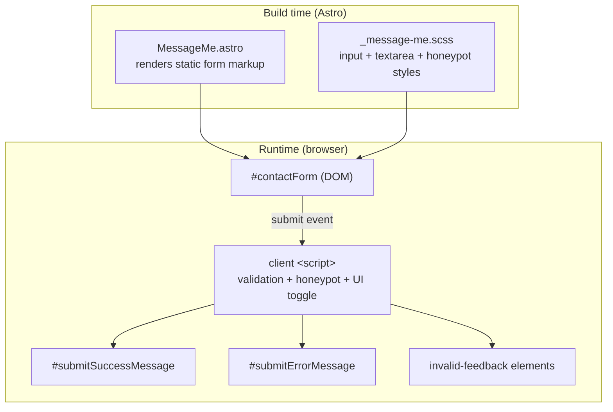
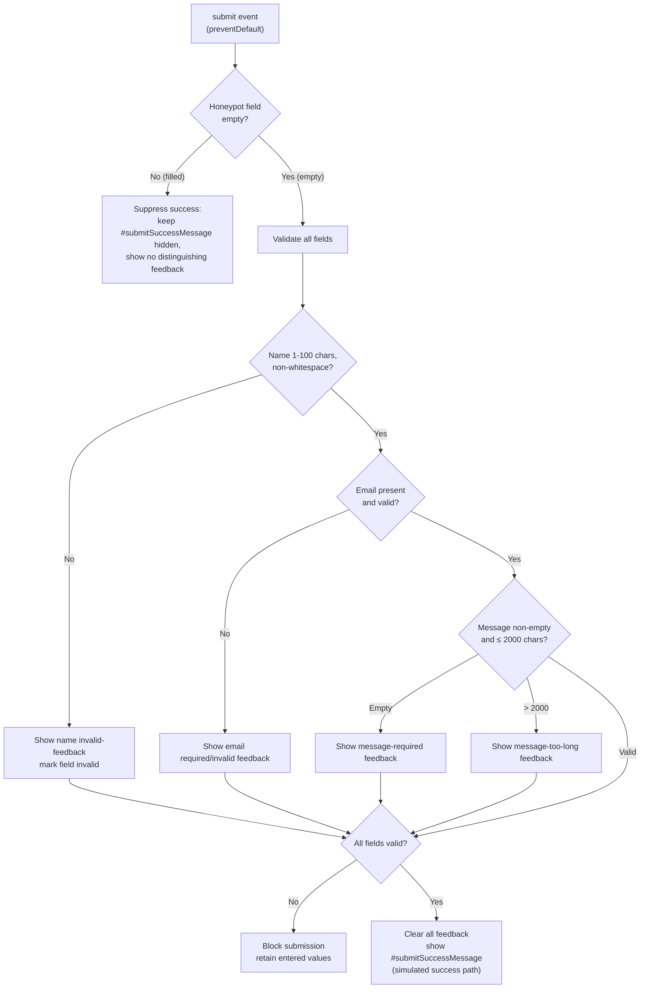

# Design Document

## Overview

This feature extends the "Send me a message" form in `src/components/MessageMe.astro` with two new input fields — a **Name_Field** and a multi-line **Message_Field** — plus a simulated, client-side-only anti-bot control implemented as a **Honeypot_Field**. The existing **Email_Field** and **Submit_Button** are preserved unchanged in structure, id, type, and class.

The current form relies on Startbootstrap **SB Forms** validation attributes (`data-sb-validations`, `data-sb-feedback`) and a hosted SB Forms JavaScript handler that activates only with a real API token. The project ships a placeholder token (`API_TOKEN`), so the form is **not functional** today: no submission is ever sent and the SB Forms script, if loaded, does nothing useful without a valid token.

Because there is no backend and no active SB Forms handler, this design takes a pragmatic hybrid approach:

1. **Keep SB Forms markup attributes** (`data-sb-validations` / `data-sb-feedback`) on all fields for markup consistency with the Grayscale theme and the existing email field. This keeps the component visually and structurally cohesive and preserves the ability to later activate SB Forms with a real token.
2. **Add a small, self-contained client-side script** (in the Astro component's client `<script>` block) that owns the actual behavior this feature requires: field validation, the honeypot check, clearing feedback on valid input, and toggling the existing success/error containers. This is necessary because SB Forms is inert without a token, and the feature's acceptance criteria (required name, required message, 2000-char max, honeypot suppression, feedback clearing) must work on a purely static site.

### Key Design Decisions

| Decision | Choice | Rationale |
|---|---|---|
| New field validation mechanism | SB Forms attributes for markup + custom client script for behavior | SB Forms is inert without a token; the custom script guarantees the required behavior works on a static site while preserving consistent markup. |
| Anti-bot mechanism | **Honeypot_Field** (not a visitor challenge) | Zero visitor friction, no network requests, no third-party dependency, purely client-side — exactly matching the "simulated / fake" intent in the requirements. A visible challenge would add friction and complexity for a decorative control. |
| Honeypot hiding technique | CSS off-screen positioning + `tabindex="-1"` + `aria-hidden="true"` + `autocomplete="off"` | Off-screen (not `display:none`) keeps the field present for naive bots that fill all inputs, while remaining invisible, unfocusable, and absent from the accessibility tree for humans and screen readers. |
| SCSS strategy | Extend `.form-signup input` selector to also target `textarea`; add visually-hidden honeypot rule | Keeps the new textarea visually consistent with existing inputs and hides the honeypot without touching unrelated styles. |
| Field reading order | Name, Email, Message, Antibot (honeypot), Submit | Matches Requirement 5.3 and a natural "who / how to reach / what" flow. |

### Anti-Bot: Alternative Considered

A simple decorative **challenge** (e.g. a "type the word SEND to confirm" text input, or a lightweight arithmetic question) was considered. It satisfies Requirement 4.6's conditional branch but adds visitor friction and extra UI state for what is explicitly a decorative control. The honeypot is chosen because it is invisible to humans, requires no interaction, and better matches the stated goal of deterring casual automated submissions without friction. The requirements phrase anti-bot criteria as `WHERE the Antibot_Control is implemented as a Honeypot_Field` vs. `WHERE ... implemented as a challenge`, so selecting the honeypot branch fully satisfies the requirement; the challenge branch is intentionally not implemented.

## Architecture

The feature lives entirely in the browser. There is no server component, no build-time data, and no network I/O. The Astro component renders static markup at build time; a client-side script attached to the component handles all interaction.



### Submit-Handling Flow

The client script intercepts the form's `submit` event, runs the anti-bot check first, then field validation, then toggles the appropriate outcome container. The honeypot is checked before validation so a bot that fills every field (including hidden ones) is silently dropped without any distinguishing feedback.



On any field `input` event, the script re-checks that single field and clears its feedback once the field becomes valid (Requirements 1.5, 3.6).

## Components and Interfaces

### Component: `MessageMe.astro`

A single Astro component. The frontmatter (`---` block) stays presentational only — no server data is needed. Markup is extended with the new fields; a client `<script>` block is added for behavior.

#### Rendered Markup Structure

```
<section id="signup" class="signup-section">
  <div class="container ...">
    <div class="row ...">
      <div class="col-md-10 col-lg-8 mx-auto text-center">
        <i class="far fa-paper-plane ..."></i>
        <h2>Send me a message</h2>

        <form id="contactForm" class="form-signup" data-sb-form-api-token="API_TOKEN">

          <!-- 1. Name -->
          <div class="row mb-2">
            <div class="col">
              <input id="name" name="name" class="form-control" type="text"
                     maxlength="100"
                     placeholder="Enter your name..."
                     aria-label="Enter your name..."
                     data-sb-validations="required" />
            </div>
          </div>
          <div class="invalid-feedback" data-sb-feedback="name:required">A name is required.</div>

          <!-- 2. Email (existing, with submit button) -->
          <div class="row input-group-newsletter">
            <div class="col">
              <input id="emailAddress" class="form-control" type="email"
                     placeholder="Enter email address..."
                     aria-label="Enter email address..."
                     data-sb-validations="required,email" />
            </div>
            <div class="col-auto">
              <button id="submitButton" class="btn btn-primary" type="submit">Notify Me!</button>
            </div>
          </div>
          <div class="invalid-feedback" data-sb-feedback="emailAddress:required">An email is required.</div>
          <div class="invalid-feedback" data-sb-feedback="emailAddress:email">Email is not valid.</div>

          <!-- 3. Message -->
          <div class="row mt-2">
            <div class="col">
              <textarea id="message" name="message" class="form-control" rows="4"
                        maxlength="2000"
                        placeholder="Enter your message..."
                        aria-label="Enter your message..."
                        data-sb-validations="required"></textarea>
            </div>
          </div>
          <div class="invalid-feedback" data-sb-feedback="message:required">A message is required.</div>
          <div class="invalid-feedback" data-sb-feedback="message:maxlength">Message must be 2000 characters or fewer.</div>

          <!-- 4. Antibot: honeypot (visually hidden) -->
          <div class="honeypot-field" aria-hidden="true">
            <label for="contactCompany">Company (leave blank)</label>
            <input id="contactCompany" name="contactCompany" type="text"
                   tabindex="-1" autocomplete="off" />
          </div>

          <!-- existing outcome containers, unchanged -->
          <div id="submitSuccessMessage" class="d-none">...</div>
          <div id="submitErrorMessage" class="d-none">...</div>
        </form>
      </div>
    </div>
  </div>
</section>
```

Notes:
- The Submit_Button loses the standalone `disabled` class from the current markup so the custom handler receives the submit event. (The current `disabled` class is dead weight anyway because SB Forms is inert.) Its id, type, and `btn btn-primary` classes are retained per Requirement 3.2.
- `maxlength="100"` / `maxlength="2000"` provide a native first line of defense; the script still validates explicitly so the correct feedback message is shown and whitespace-only input is rejected (native `maxlength` does not cover the "required / whitespace-only" case, and paste or programmatic input can exceed limits in edge cases).

#### Client Script Interface

The client `<script>` block (bundled by Astro) exposes no public API; it wires DOM event listeners. Its internal structure:

```ts
// Element handles
const form = document.getElementById('contactForm') as HTMLFormElement | null;
const honeypot = document.getElementById('contactCompany') as HTMLInputElement | null;
const nameEl = document.getElementById('name') as HTMLInputElement | null;
const emailEl = document.getElementById('emailAddress') as HTMLInputElement | null;
const messageEl = document.getElementById('message') as HTMLTextAreaElement | null;

const MAX_MESSAGE_LENGTH = 2000;
const MAX_NAME_LENGTH = 100;

type FieldKey = 'name' | 'emailAddress' | 'message';

// Pure validators (unit-/property-testable, exported for tests)
function isHoneypotTriggered(value: string): boolean;        // value.length > 0
function validateName(value: string): 'required' | null;     // trimmed length 1..100
function validateEmail(value: string): 'required' | 'email' | null;
function validateMessage(value: string): 'required' | 'maxlength' | null;

// DOM glue
function showFeedback(fieldKey: FieldKey, reason: string): void;  // toggle matching invalid-feedback + add is-invalid
function clearFeedback(fieldKey: FieldKey): void;                 // hide feedback + remove is-invalid
function handleSubmit(event: SubmitEvent): void;                 // honeypot -> validate -> toggle outcome
```

To keep the pure validators testable without a DOM, they are authored as a small module (e.g. `src/scripts/messageme-validation.ts`) and imported by the component script. The DOM glue stays in the component `<script>`.

### Honeypot rationale (interface-level)

- `honeypot-field` wrapper is positioned off-screen via SCSS (not `display:none`), so bots that read/complete all inputs still fill it, while it is invisible to humans.
- `aria-hidden="true"` removes it from the accessibility tree (Requirement 4.3).
- `tabindex="-1"` removes it from keyboard tab order (Requirement 4.3).
- `autocomplete="off"` prevents browser autofill from populating it (which would cause false positives for real visitors).

## Data Models

There are no persisted or transmitted data models — the form issues zero network requests. The only runtime state is transient in-memory form state used by the validation logic.

### FormInput (in-memory snapshot read from the DOM at submit time)

| Field | Source element | Type | Constraints |
|---|---|---|---|
| `name` | `#name` | string | trimmed length 1–100, at least one non-whitespace char |
| `emailAddress` | `#emailAddress` | string | non-empty, matches email pattern |
| `message` | `#message` | string | length 1–2000 |
| `contactCompany` (honeypot) | `#contactCompany` | string | expected empty for humans |

### ValidationResult

| Field | Type | Meaning |
|---|---|---|
| `valid` | boolean | true when every field validator returns `null` |
| `errors` | `Record<FieldKey, string \| null>` | per-field failure reason key (`required`, `email`, `maxlength`) or `null` |

### Outcome (what the submit handler produces)

| Outcome | Condition | Visible effect |
|---|---|---|
| `silently-dropped` | honeypot non-empty | no success, no distinguishing feedback (indistinguishable from idle) |
| `blocked` | honeypot empty AND `ValidationResult.valid === false` | relevant invalid-feedback shown, values retained, no success |
| `success` | honeypot empty AND `ValidationResult.valid === true` | all feedback cleared, `#submitSuccessMessage` shown (simulated) |

## Correctness Properties

*A property is a characteristic or behavior that should hold true across all valid executions of a system — essentially, a formal statement about what the system should do. Properties serve as the bridge between human-readable specifications and machine-verifiable correctness guarantees.*

These properties target the pure validation layer (`src/scripts/messageme-validation.ts`) and the submit-outcome function, which take string inputs and return structured results. Rendering/attribute concerns (placeholders, aria-labels, class names, DOM order, honeypot styling) are covered by example and rendering tests in the Testing Strategy, not by properties.

### Property 1: Name validation matches the 1–100 non-whitespace rule

*For any* string `s`, `validateName(s)` returns `null` if and only if `s.trim()` has length between 1 and 100 inclusive, and returns `'required'` otherwise; consequently a name that was invalid becomes valid (and its feedback is cleared) exactly when the entered value gains at least one non-whitespace character within the length bound.

**Validates: Requirements 1.1, 1.4, 1.5**

### Property 2: Email validation classifies empty, invalid, and valid inputs

*For any* string `s`, `validateEmail(s)` returns `'required'` when `s` is empty, `'email'` when `s` is non-empty but does not match the email pattern, and `null` when `s` is a valid email; the form blocks submission if and only if the result is non-`null`, and clears email feedback when the result is `null`.

**Validates: Requirements 3.4, 3.5, 3.6**

### Property 3: Message length validation enforces the 1–2000 bound

*For any* string `s`, `validateMessage(s)` returns `'required'` when `s` is empty, `'maxlength'` when `s` has length greater than 2000, and `null` when `s` has length between 1 and 2000 inclusive.

**Validates: Requirements 2.1, 2.4, 2.5**

### Property 4: Honeypot gates the success path with indistinguishable handling

*For any* honeypot value `h` and otherwise-valid field inputs, the submission reaches the success path if and only if `h` is empty; when `h` is non-empty the success container stays hidden and no feedback is shown that distinguishes a detected bot from an ordinary idle/blocked form.

**Validates: Requirements 4.4, 4.5**

### Property 5: Submit outcome and value retention

*For any* combination of name, email, message, and honeypot inputs, the submit handler produces `success` if and only if the honeypot is empty and all three field validators return `null`; in every non-success outcome the handler blocks submission and leaves the entered values of all fields unchanged.

**Validates: Requirements 2.4, 2.5, 1.4, 3.4, 4.4**

## Error Handling

This is a client-only feature with no network or persistence, so "errors" are user-input validation failures and defensive DOM guards.

- **Validation failures**: Each failing field toggles its matching `invalid-feedback` element (keyed by `data-sb-feedback="field:reason"`) and adds `is-invalid` to the field. The submit handler calls `event.preventDefault()` on any failure so the browser never performs a native submit. Entered values are never cleared on failure (Requirements 2.4, 2.5).
- **Honeypot trip**: Treated as a silent non-success. No error is surfaced; the form simply does not show success, making a bot detection indistinguishable from a form left idle (Requirement 4.4).
- **Missing DOM elements**: The client script null-checks each `getElementById` handle and returns early if the form or a required field is absent, so a markup change cannot throw at runtime.
- **Over-length paste**: Native `maxlength` caps typed input, but the script still validates length explicitly (handling programmatic/paste edge cases) and shows the `maxlength` feedback rather than silently truncating.
- **Existing SB Forms / API token**: The placeholder `API_TOKEN` remains; the custom handler owns behavior regardless of whether the SB Forms script loads. The simulated success path shows the existing `#submitSuccessMessage` content, which already explains the form is a demo.

## Testing Strategy

The feature combines pure validation logic (well suited to property-based testing) with UI rendering and attribute concerns (suited to example/rendering tests). The strategy uses both.

### Tooling

- **Test runner**: Vitest (the standard choice for Astro/Vite projects; integrates with the existing Vite pipeline). No test framework is currently installed, so this introduces `vitest` plus `jsdom` (or `happy-dom`) for DOM assertions.
- **Property-based library**: `fast-check` (the standard PBT library for TypeScript/JavaScript). Property tests MUST NOT be hand-rolled; `fast-check` generates and shrinks inputs.
- **DOM rendering**: for rendering/attribute assertions, render the component's markup (via Astro's `experimental` container API or by asserting against the extracted markup) into jsdom and query elements.

### Property-Based Tests

Each correctness property is implemented by a **single** property-based test running a **minimum of 100 iterations**, tagged with a comment referencing the design property.

Tag format: `// Feature: messageme-form-fields, Property {number}: {property_text}`

| Property | Generator focus |
|---|---|
| Property 1 (name) | arbitrary strings incl. whitespace-only, empty, and boundary lengths 1 / 100 / 101 |
| Property 2 (email) | empty, random non-email strings, and generated valid emails (`fc.emailAddress()`) |
| Property 3 (message) | strings around the boundaries 0 / 1 / 2000 / 2001 and large lengths |
| Property 4 (honeypot) | arbitrary honeypot strings (empty vs non-empty) with otherwise-valid fields |
| Property 5 (outcome + retention) | tuples of name/email/message/honeypot covering all pass/fail combinations |

The pure validators (`validateName`, `validateEmail`, `validateMessage`, `isHoneypotTriggered`) and the outcome computation are exported from `src/scripts/messageme-validation.ts` so they can be exercised directly, without a DOM, keeping iterations cheap.

### Example / Rendering Tests

Static, input-invariant criteria are covered by example tests (not PBT), since their behavior does not vary with input:

- Name input: `form-control` class, non-empty `placeholder`, `aria-label` equal to placeholder (Requirements 1.2, 1.3, 5.1).
- Textarea: `rows` ≥ 3, `maxlength="2000"`, `form-control`, `placeholder` non-empty, `aria-label` equal to placeholder (Requirements 2.1, 2.2, 2.3, 5.2).
- Email input and submit button: ids, types, classes, and `data-sb-validations` preserved (Requirements 3.1, 3.2, 3.3).
- Honeypot: `tabindex="-1"`, `aria-hidden="true"`, `autocomplete="off"`, and off-screen/visually-hidden styling applied (Requirements 4.3, 5.4).
- DOM order Name → Email → Message → Honeypot → Submit (Requirement 5.3).
- `#submitSuccessMessage` and `#submitErrorMessage` present with `d-none` (Requirement 5.5).

### Integration Tests (network behavior)

Requirements 4.1 and 4.2 assert zero network traffic. These are verified with 1–2 integration tests that spy on `fetch` and `XMLHttpRequest` in jsdom, dispatch a `submit`, and assert no outbound request is issued. This is not a property (behavior does not vary with input and 100 iterations add no value).

### Not Covered by Tests

- Requirement 4.6 (challenge branch) is intentionally not implemented because the honeypot branch was selected; it is documented in Architecture as the unselected design alternative.
